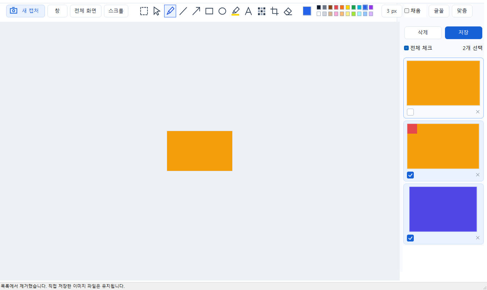

# LightCapture

Windows 11 **x64**용 캡처·이미지 편집 도구입니다. C++17과 Windows API/GDI+로 작성했으며 .NET·브라우저 런타임 없이 실행합니다. Win32는 Windows API의 이름이며 실행 파일은 64비트 AMD64입니다.

현재 버전은 **0.1.17 개발 검증판**입니다. Ctrl+S로 체크 여부와 관계없이 현재 편집 화면의 이미지 한 장을 저장합니다. 파일 이름·위치·형식을 고르는 저장창이 열리며 입력 중인 텍스트도 확정해 반영합니다. 목록 상단 저장 버튼은 기존처럼 체크한 캡처를 저장합니다. [0.1.17 수정 기록](docs/수정기록-0.1.17.md)과 [디자인 기준](DESIGN.md)을 참고하세요. 실제 화면 환경과 알캡처의 모든 동작을 대조해 통과한 정식 완성본은 아닙니다. 이전 [사각형 선택·이동](docs/수정기록-0.1.13.md), [복사 호환성](docs/수정기록-0.1.12.md) 변경도 유지합니다.

## 실행

1. 이 저장소를 다운로드해 압축을 풀고 [bin/LightCapture.exe](bin/LightCapture.exe)를 실행합니다. GitHub 파일 페이지의 다운로드 버튼으로 실행 파일만 받을 수도 있습니다.
2. 구버전이 실행 중이면 먼저 트레이 메뉴에서 종료합니다. 새 파일 실행만으로 기존 프로세스가 교체되지는 않습니다.
3. **Ctrl+Shift+X**를 누르고 영역을 드래그합니다. 캡처 중 다시 누르면 취소합니다.
4. 현재 보고 있는 한 장은 **Ctrl+S**로 파일 이름과 저장 위치를 지정해 저장합니다. 여러 장은 오른쪽 목록에서 사진이나 체크박스로 저장 대상을 체크하고 **저장**을 누릅니다. 전체 저장은 **전체 체크 → 저장**입니다.

자세한 설명: **[사용법](docs/사용법.md)** · **[개발·빌드](docs/개발.md)** · **[검증 범위](docs/검증.md)**.

## 주요 기능

- 영역·자유형·창·단위영역·전체 화면·현재 모니터·크기 지정·스크롤 캡처
- 캡처 중 상단 작업 박스에서 영역·창·전체 화면·최근 목록 선택
- 펜·직선·화살표·도형·형광펜·텍스트·모자이크·자르기·지우개와 색상 팔레트
- 그림판식 사각형 선택: 사진 일부를 떼어 이동, 선택 부분만 복사, Ctrl+Z 복원
- 사진 클릭 체크 전환, Shift+클릭 범위 체크, 전체 체크
- 목록 상단 **[삭제] [저장]**: 체크한 캡처만 처리
- Ctrl+C로 현재 편집 이미지 복사, Ctrl+Z로 실행 취소
- Windows 탐색기형 저장 폴더 선택과 파일명 충돌 시 번호 추가
- 닫기 시 트레이 대기, 전역 단축키 변경, 시작 프로그램 설정

## 단축키

| 키 | 동작 |
| --- | --- |
| Ctrl+Shift+X | 캡처 시작 / 캡처 중 취소 |
| Ctrl+S | 현재 편집 이미지 한 장 저장 |
| Ctrl+Shift+S | 현재 사진 한 장을 다른 이름으로 저장 |
| Ctrl+C | 선택 영역이 있으면 그 부분만, 없으면 전체 편집 이미지 복사. 텍스트 입력 중에는 선택한 글자 복사 |
| Ctrl+Z | 이미지 편집 실행 취소. 텍스트 입력 중에는 글자 입력 실행 취소 |
| Shift+클릭 | 목록의 기준 항목부터 범위 체크 |
| F4 | 환경설정 |

## 보관과 검증

0.1.13의 사각형 선택·이동 검증은 [최신 검증 범위](docs/검증.md)를 참고하세요. 도구 모음 맨 왼쪽 점선 사각형 아이콘을 누르고 사진에서 영역을 드래그한 뒤, 선택한 부분의 안쪽을 드래그해 옮깁니다. 원래 자리는 흰색으로 채워집니다.

기본 내부 보관 위치는 `%LOCALAPPDATA%\LightCapture`입니다. 캡처 직후 결과 이미지를 지정 폴더에 자동 내보내지는 않으며, 재실행 후 목록 복원을 위한 내부 원본·편집 기록은 저장합니다.

0.1.12 기준 핵심 회귀 시험 **49개**, 이미지 복사 형식·픽셀 시험 **11개**, 실제 Windows 클립보드 송수신을 포함한 확장 시험 **27개**를 통과했습니다. 확장 시험은 기본 11개를 포함하며 사용자 허용 후 검증용 이미지로 수행했습니다. 자체 숨긴 컨트롤과 합성 이미지로 편집·저장·체크 삭제 등의 회귀도 확인했습니다. 실제 카카오톡 붙여넣기, 물리 키 입력, 혼합 DPI·다중 모니터, 실제 캡처 잔상 제거, 장시간 메모리·반응속도 및 알캡처 직접 비교는 검증 범위에 한계가 있습니다.

이 저장소에는 사용자 캡처 사진·설정·개인 경로·도구체인·임시 데이터는 포함하지 않습니다. 소스와 그래픽 리소스는 이 프로젝트에서 작성했으며 알캡처·ShareX 코드를 복사하지 않았습니다. 외부 런타임 고지는 [THIRD_PARTY_NOTICES.md](THIRD_PARTY_NOTICES.md)를 참고하세요. 실행 파일에는 코드 서명이 없습니다.
