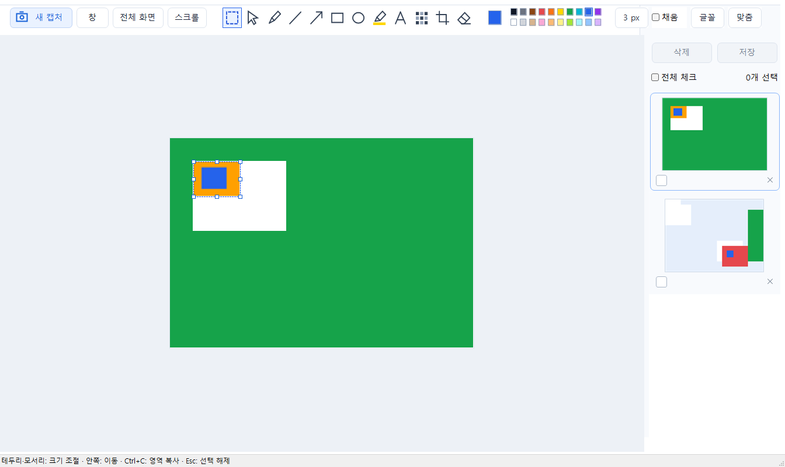
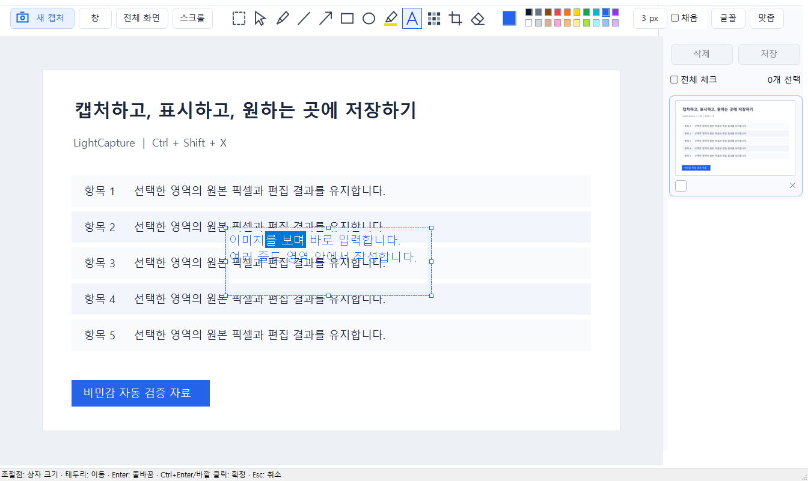

# LightCapture 0.1.21 사용법

목록 항목의 클릭·키보드 포커스는 둥근 테두리 하나로 표시합니다. 안쪽에 겹쳐 보이던 각진 점선 테두리는 제거했으며 썸네일 자체의 연한 테두리는 유지합니다.

1번 Fluent Light의 흰색 도구 모음과 파란 저장 버튼을 사용합니다. 0.1.15에서는 오른쪽 목록 폭을 이전의 약 2/3로 줄이고 이미지 미리보기를 크게 표시합니다. 해상도·캡처 시간은 표시하지 않습니다. 각 썸네일에는 연한 테두리를 두르며 체크박스와 개별 제거 X는 아래쪽에 있습니다. 체크된 항목은 옅은 파랑, 현재 편집 항목은 파란 테두리로 표시합니다. 작은 창에서는 도구 그룹이 줄바꿈됩니다.

## 시작과 종료

Windows 11 x64에서 `bin/LightCapture.exe`를 실행합니다. 같은 앱은 한 번만 실행합니다. 업데이트할 때는 트레이에서 이전 버전을 종료한 뒤 새 파일을 실행합니다. 창의 ×는 트레이로 숨기며 완전 종료는 파일 메뉴 또는 트레이의 프로그램 종료를 사용합니다.

## 캡처

**Ctrl+Shift+X**를 누르고 영역을 드래그합니다. 앱은 편집창·소유 팝업을 숨기고 창 숨김·화면 합성 상태를 연속 확인한 다음 선택 화면을 표시하도록 구현되어 있습니다. 실제 사용자 화면에서의 잔상 제거는 별도 확인이 필요합니다.

캡처 중 상단 작업 박스에서 영역·창·전체 화면·최근 목록·더 보기·취소를 선택합니다. 이 작업 박스는 캡처 중에만 표시합니다. 캡처 중 단축키를 다시 누르면 진행 중인 캡처를 취소하고 편집창도 숨깁니다. 기존 목록은 유지합니다. Esc·마우스 오른쪽 버튼으로도 취소할 수 있으며 이 경우 이전 편집창으로 복귀할 수 있습니다.

캡처 메뉴에는 자유형·단위영역·현재 모니터·크기 지정·세로/가로/수동 스크롤이 있습니다. 단위영역은 하위 HWND 경계 기준이므로 브라우저 내부 요소 모두를 찾지는 않습니다. 스크롤 캡처는 대상 앱·고정 헤더·움직이는 콘텐츠에 따라 연결이 실패할 수 있습니다.

## 흰색 캔버스로 그림판 사용

상단 **그림판** 버튼, 파일 → 새 그림판 또는 **Ctrl+N**을 누릅니다. 1280×720의 흰색 불투명 캔버스가 오른쪽 목록 맨 위에 추가되고 편집 화면도 바로 전환되며 펜이 선택됩니다. 버튼을 다시 누르면 별도의 새 캔버스를 추가합니다. 기존 캡처·그림과 체크 상태는 목록에 남으며, 입력 중이던 텍스트는 기존 이미지에 먼저 확정합니다. 목록 보관 한도는 캡처와 동일합니다.

펜·도형·텍스트·팔레트·영역 선택을 그대로 사용하고 Ctrl+Z로 되돌립니다. **Ctrl+S는 현재 그림 한 장**, 목록 상단 저장은 체크한 그림·캡처를 저장합니다. Ctrl+C로 현재 편집 결과를 복사하며 선택 영역이 있으면 그 부분만 복사합니다. 직접 파일로 저장하지 않아도 내부 목록에 남아 재실행 후 다시 편집할 수 있습니다. 기존 자동 내보내기 정책과 마찬가지로 파일 내보내기는 저장 명령에서만 수행합니다.

## 캡처 이미지의 편집 공간 넓히기

캡처·그림판 이미지의 **오른쪽 또는 아래쪽 가장자리**에 마우스를 올립니다. 해당 가장자리만 파란 선과 작은 점으로 강조되고 크기 조절 커서가 나타납니다. 마우스를 치우면 표시도 사라집니다. 오른쪽 가장자리를 바깥으로 끌면 가로, 아래쪽은 세로, 오른쪽 아래 모서리는 가로·세로를 함께 넓힙니다. 새 공간은 흰색이며 기존 캡처와 편집 내용은 늘어나거나 변형되지 않습니다.

마우스를 놓으면 한 번의 편집으로 확정합니다. **Ctrl+Z**는 마지막 확장을 되돌리고 드래그 중 **Esc**는 취소합니다. 안쪽으로 드래그해도 기존 그림을 잘라내지 않습니다. 넓힌 여백에도 기존 도구로 그릴 수 있고 저장·복사 시 전체 편집 범위를 반영합니다. 가장자리가 화면 밖에 있으면 Ctrl+휠로 축소하거나 Space+드래그로 화면을 이동합니다. 텍스트·영역·개체를 편집 중이면 먼저 바깥을 클릭하거나 Esc로 선택을 해제한 뒤 가장자리로 이동합니다.

## 복사한 이미지 붙여넣기

다른 앱에서 **이미지 자체를 복사**한 뒤 LightCapture 편집 화면을 클릭하고 **Ctrl+V** 또는 편집 → 이미지 붙여넣기를 실행합니다. 현재 문서 위에 이미지를 붙이고 개체 선택 도구로 전환합니다. 이미지 파일 경로·웹 주소·파일 아이콘만 복사한 클립보드는 이미지 붙여넣기 대상으로 보지 않습니다.

- 붙인 이미지 안쪽을 드래그하면 위치가 바뀝니다.
- 오른쪽 아래 모서리 또는 Shift+드래그로 크기를 조절합니다.
- 붙여넣은 이미지가 현재 캔버스보다 크면 잘리지 않도록 오른쪽·아래 공간이 자동 확장됩니다. Ctrl+Z 한 번으로 이 붙여넣기와 자동 확장을 함께 되돌립니다.
- 투명도가 있는 PNG는 투명 배경을 유지합니다. 일반 DIB·DIBV5·비트맵 형식도 읽습니다.
- 빈 목록에서도 붙여넣을 수 있으며 복사한 이미지로 새 문서를 만듭니다.
- 기존 텍스트 입력 상자 안에서 Ctrl+V는 글자 붙여넣기입니다. 이미지 붙여넣기는 입력을 확정하거나 편집 메뉴를 사용합니다.

확장·붙여넣기가 포함된 내부 기록은 **0.1.21 이상**에서 다시 엽니다. 기존 캡처 기록은 계속 열 수 있습니다. 캔버스는 최대 한 변 32,000px·전체 64메가픽셀 범위에서 확장합니다. 붙여넣은 압축 이미지 데이터는 한 장 64MiB, 문서 내 고유 데이터 합계 128MiB로 제한하며 이동·크기 조절 시 같은 데이터를 재사용합니다.

## 펜 굵기 조절

펜을 선택하면 편집 화면 **왼쪽에 세로 막대**가 나타납니다. 막대를 **위로 드래그하면 굵게, 아래로 드래그하면 얇게** 바뀝니다. 막대 위에서 마우스 휠을 위·아래로 돌리면 1px씩 조절합니다. 현재 값은 막대 위에 표시되며 범위는 **1~80px**입니다. 막대에 포커스를 두고 방향키·Home·End로도 조절할 수 있습니다. 새로 그리는 선부터 적용하며 이미 그린 선은 바꾸지 않습니다.

다른 도구를 선택하면 굵기 막대는 숨겨집니다. 마지막 굵기는 다시 펜을 선택해도 유지하고 다른 선 도구에서도 공통 굵기로 사용합니다. 상단 굵기 드롭다운과 맞춤 버튼·메뉴는 제거했습니다. 이미지를 열거나 선택할 때의 초기 배율은 창에 맞춰 정하며, Ctrl+휠 확대·축소와 Space+드래그 화면 이동은 유지합니다.

## 편집

### 그림판식 사각형 선택·이동·크기 조절

1. 상단 도구 모음 **맨 왼쪽 점선 사각형 아이콘**을 고릅니다. 마우스를 올리면 '사각형 선택 / 이동'이 표시됩니다.
2. 사진 위에서 사각형으로 드래그하면 점선 선택 테두리가 생깁니다.
3. 선택 영역 **안쪽을 다시 드래그**해 원하는 위치로 옮깁니다. 원래 자리는 흰색으로 채우며 도착 위치의 기존 픽셀은 덮어씁니다. 사진과 이전에 그린 내용이 함께 이동합니다.
4. 선택 **테두리 또는 모서리의 작은 사각형을 드래그**하면 사진과 기존 주석의 크기가 함께 바뀝니다. 좌우 테두리는 너비, 위아래 테두리는 높이, 모서리는 너비와 높이를 조절합니다. 마우스 커서가 방향에 맞는 화살표로 바뀝니다.
5. 마우스를 놓으면 한 번의 편집으로 적용합니다. 선택 영역은 남아 다시 이동하거나 크기를 조절할 수 있습니다. Ctrl+Z 한 번으로 마지막 이동·크기 조절과 덮어쓴 도착 위치를 복원합니다.
6. **Esc 또는 영역 바깥 클릭**으로 선택을 해제합니다. 이동·크기 조절 중 Esc는 아직 적용하지 않은 드래그만 취소합니다. 다른 도구나 사진으로 바꿔도 선택 테두리는 해제됩니다.

선택한 상태에서 **Ctrl+C는 선택한 부분만 복사**합니다. 선택을 해제하면 사진 전체를 복사합니다. 저장은 선택 유무와 관계없이 현재 사진 전체의 편집 결과를 내보냅니다. 이동은 사진의 현재 보이는 범위 안으로 제한하며 자르기가 적용돼 있으면 그 범위를 사용합니다. 크기 조절은 가로·세로 비율을 자유롭게 바꾸며 최소 1×1픽셀과 현재 보이는 사진 경계로 제한합니다. 축소해 비는 원래 자리는 흰색이며 확대·이동한 도착 위치는 덮어씁니다. 자유형 선택은 포함하지 않습니다. 외부 이미지 붙여넣기는 Ctrl+V를 사용합니다.

사각형 선택은 원본 픽셀과 주석을 합쳐 이동하거나 크기를 조절합니다. 이동 이전의 주석은 이후 개체 선택·지우개로 개별 편집하지 않고, 이동을 Ctrl+Z로 되돌린 뒤 수정합니다. 이동 후 새로 그린 주석은 기존처럼 개별 편집합니다. 이동 기록은 0.1.13 이상, 크기 조절한 기록은 **0.1.18 이상**에서 다시 엽니다. 기존 화살표 아이콘은 별도의 '개체 선택 / 이동' 도구입니다.

### 기존 그리기 도구

상단 작은 아이콘에서 선택/이동·펜·직선·화살표·사각형·타원·형광펜·텍스트·모자이크·자르기·지우개를 고릅니다. 색상은 팔레트에서, 펜 굵기는 왼쪽 세로 막대에서 선택합니다. 채움·글꼴을 제공합니다.

텍스트 도구로 이미지 위에 입력 영역을 드래그한 뒤 입력합니다. 입력 중 **조절점 사이의 테두리를 드래그하면 상자 전체가 이동**합니다. **모서리와 각 변 중앙의 작은 사각형 8개를 드래그하면 상자 너비·높이가 바뀝니다.** 입력한 글자와 글자 크기는 유지되며 너비가 바뀌면 줄바꿈 위치가 달라집니다. 글을 계속 쓸 공간이 부족하면 아래쪽이나 오른쪽 조절점을 끌어 넓힙니다. 사진 경계 밖으로 이동·확대할 수 없습니다.

Enter는 줄바꿈, Ctrl+Enter 또는 바깥 클릭은 확정, Esc는 입력 취소입니다. 상자를 이동·크기 조절하는 도중 Esc는 해당 드래그만 취소하고 입력을 유지합니다. 입력 중 색상·글꼴 변경과 기존 텍스트 더블클릭 수정이 가능합니다. 기존 텍스트를 다시 편집할 때도 위치·상자 크기를 바꿀 수 있으며 확정 후 Ctrl+Z로 마지막 편집을 되돌립니다.

Ctrl+Z는 현재 이미지의 마지막 편집을 실행 취소합니다. Ctrl+C 또는 편집 → 이미지 복사는 체크 개수와 관계없이 현재 이미지의 편집 결과를 복사하며, 사각형 선택 영역이 있으면 그 부분만 복사합니다. 다른 앱에서 Ctrl+V로 붙여넣습니다. 텍스트 입력 중 Ctrl+C·Ctrl+Z는 글자 편집에 적용합니다. Ctrl+휠은 확대/축소, 휠·Shift+휠은 세로/가로 이동, Space+드래그 또는 가운데 버튼 드래그는 화면 이동입니다.

카카오톡 등에 붙여넣을 때는 캡처를 마친 뒤 **Ctrl+C → 대상 앱에서 Ctrl+V**를 사용합니다. 0.1.12는 PNG와 일반 비트맵 호환 형식을 함께 복사합니다. 복사 결과의 투명 영역은 흰색으로 처리하며 저장 파일의 투명도에는 영향을 주지 않습니다. 클립보드가 잠겨 복사에 실패하면 상태 표시줄에 재시도 안내가 나오므로 Ctrl+C를 다시 누릅니다.

이전 버전에서 회색으로 복사한 내용은 업데이트만으로 바뀌지 않습니다. 트레이에서 구버전을 종료하고 새 버전을 실행한 다음 **다시 Ctrl+C**를 눌러야 합니다. 기존 목록의 정상 사진도 새 버전에서 다시 복사할 수 있습니다. 카카오톡 자체 붙여넣기 조작 검증 여부는 [검증 기록](검증.md)을 참고합니다.

지우개는 주석 개체를 제거하며 원본 픽셀을 칠하는 지우개가 아닙니다. 모자이크는 내보내는 이미지에 반영됩니다. 내부 원본은 남으므로 공유할 때는 저장하거나 복사한 편집 결과를 사용합니다.

## 목록 선택과 삭제

오른쪽 목록의 사진을 클릭하면 체크가 켜지거나 꺼지고 해당 사진을 편집 화면에 표시합니다. 체크박스만 클릭하면 현재 편집 사진은 유지합니다. Shift+클릭은 마지막 기준 항목부터 클릭한 항목까지 연속 체크하며 다른 체크는 유지합니다. 전체 체크로 모두 켜거나 끌 수 있습니다. 파란 배경은 체크된 항목 또는 현재 편집 항목에 표시되므로 실제 작업 대상은 체크박스로 확인합니다. 체크 상태는 실행 중에만 유지됩니다.

목록 상단 **삭제**는 체크한 항목만 대상으로 개수를 확인한 뒤 목록과 내부 보관함에서 제거합니다. 취소하면 유지하며 실패 항목은 체크된 채 남습니다. 직접 저장한 결과 파일은 삭제하지 않습니다. 각 사진의 ×는 그 한 장을 즉시 제거합니다. 목록 Delete·편집 메뉴도 체크 삭제를 사용하며, 캔버스에서 선택한 편집 개체가 있을 때 Delete는 개체를 삭제합니다.

## 저장

**Ctrl+S / 파일 → 현재 캡처 저장**은 체크 여부와 관계없이 지금 편집창에서 보고 있는 이미지 한 장을 저장합니다. 파일 이름·위치·형식을 고르는 저장창이 열리며, 입력 중인 텍스트와 현재 편집 결과를 반영합니다. 사각형 선택 영역이 있어도 현재 이미지 전체를 저장합니다. 취소하면 결과 파일을 만들지 않습니다.

목록 위 **저장** 또는 파일 → 체크한 캡처 저장은 체크한 캡처만 저장합니다. 체크가 없으면 삭제·저장이 비활성화합니다. 전체 저장은 **전체 체크 → 저장**으로 수행합니다. 별도 모두 저장 버튼은 없습니다.

저장할 때 Windows 탐색기형 폴더 선택창이 열립니다. 주소 표시줄 경로 입력·왼쪽 탐색 목록·검색으로 이동하고 '이 폴더 선택'을 누릅니다. 실행 중 마지막 선택 폴더를 기억하며 재실행 시 환경설정 폴더를 사용합니다. 취소하면 결과 이미지를 내보내지 않습니다.

여러 장 저장은 환경설정의 형식·파일명 패턴을 적용하고 같은 이름이 있으면 번호를 붙입니다. PNG·JPEG·BMP·GIF·TIFF를 지원합니다. 현재 사진 한 장의 이름·위치·형식을 직접 지정하려면 **파일 → 다른 이름으로 저장 / Ctrl+Shift+S**를 사용합니다.

캡처 결과의 자동 내보내기는 하지 않습니다. 재실행 후 목록을 복원하기 위한 내부 원본과 편집 기록은 저장합니다. 최근 목록은 기본 100장이며 환경설정에서 100~1000장으로 정할 수 있습니다. 한도를 넘으면 오래된 내부 항목을 정리하므로 오래 보관할 사진은 별도로 저장합니다.

## 환경설정과 문제 해결

F4 또는 환경설정 메뉴에서 전역 키·시작 프로그램·포인터 포함·지연·크기 지정·저장 경로/형식/파일명·JPEG 품질·목록 한도·외부 편집기를 정합니다. 같은 키를 다른 앱이 등록했다면 해당 앱의 키를 해제하거나 다른 키를 설정합니다.

기본 데이터 위치는 `%LOCALAPPDATA%\LightCapture`이며 captures 폴더에 원본·편집 기록, settings.ini에 설정, view.ini에 창 상태를 저장합니다. diagnostics.log·recovery.log는 오류 진단용입니다. 내부 데이터 파일을 수동으로 이동·삭제하면 복원에 영향을 줍니다. 실행 파일만 교체해도 내부 보관 위치는 유지됩니다.
