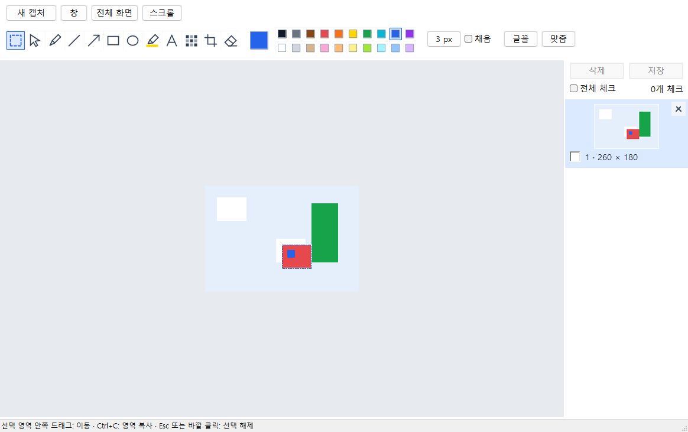

# LightCapture 0.1.13 사용법

## 시작과 종료

Windows 11 x64에서 `bin/LightCapture.exe`를 실행합니다. 같은 앱은 한 번만 실행합니다. 업데이트할 때는 트레이에서 이전 버전을 종료한 뒤 새 파일을 실행합니다. 창의 ×는 트레이로 숨기며 완전 종료는 파일 메뉴 또는 트레이의 프로그램 종료를 사용합니다.

## 캡처

**Ctrl+Shift+X**를 누르고 영역을 드래그합니다. 앱은 편집창·소유 팝업을 숨기고 창 숨김·화면 합성 상태를 연속 확인한 다음 선택 화면을 표시하도록 구현되어 있습니다. 실제 사용자 화면에서의 잔상 제거는 별도 확인이 필요합니다.

캡처 중 상단 작업 박스에서 영역·창·전체 화면·최근 목록·더 보기·취소를 선택합니다. 이 작업 박스는 캡처 중에만 표시합니다. 캡처 중 단축키를 다시 누르면 진행 중인 캡처를 취소하고 편집창도 숨깁니다. 기존 목록은 유지합니다. Esc·마우스 오른쪽 버튼으로도 취소할 수 있으며 이 경우 이전 편집창으로 복귀할 수 있습니다.

캡처 메뉴에는 자유형·단위영역·현재 모니터·크기 지정·세로/가로/수동 스크롤이 있습니다. 단위영역은 하위 HWND 경계 기준이므로 브라우저 내부 요소 모두를 찾지는 않습니다. 스크롤 캡처는 대상 앱·고정 헤더·움직이는 콘텐츠에 따라 연결이 실패할 수 있습니다.

## 편집

### 그림판식 사각형 선택·이동

1. 상단 도구 모음 **맨 왼쪽 점선 사각형 아이콘**을 고릅니다. 마우스를 올리면 '사각형 선택 / 이동'이 표시됩니다.
2. 사진 위에서 사각형으로 드래그하면 점선 선택 테두리가 생깁니다.
3. 선택 영역 **안쪽을 다시 드래그**해 원하는 위치로 옮깁니다. 원래 자리는 흰색으로 채우며 도착 위치의 기존 픽셀은 덮어씁니다. 사진과 이전에 그린 내용이 함께 이동합니다.
4. 마우스를 놓으면 한 번의 편집으로 적용합니다. 선택 영역은 남아 다시 이동할 수 있습니다. Ctrl+Z는 마지막 이동과 덮어쓴 도착 위치를 복원합니다.
5. **Esc 또는 영역 바깥 클릭**으로 선택을 해제합니다. 이동 중 Esc는 아직 적용하지 않은 드래그만 취소합니다. 다른 도구나 사진으로 바꿔도 선택 테두리는 해제됩니다.

선택한 상태에서 **Ctrl+C는 선택한 부분만 복사**합니다. 선택을 해제하면 사진 전체를 복사합니다. 저장은 선택 유무와 관계없이 현재 사진 전체의 편집 결과를 내보냅니다. 이동은 사진의 현재 보이는 범위 안으로 제한하며 자르기가 적용돼 있으면 그 범위를 사용합니다. 선택 크기 변경·자유형 선택·외부 이미지 붙여넣기는 이번 기능에 포함하지 않았습니다.

사각형 선택은 원본 픽셀과 주석을 합쳐 이동합니다. 이동 이전의 주석은 이후 개체 선택·지우개로 개별 편집하지 않고, 이동을 Ctrl+Z로 되돌린 뒤 수정합니다. 이동 후 새로 그린 주석은 기존처럼 개별 편집합니다. 이 기능으로 편집한 기록을 다시 열 때는 0.1.13 이상을 사용합니다. 기존 화살표 아이콘은 별도의 '개체 선택 / 이동' 도구입니다.

### 기존 그리기 도구

상단 작은 아이콘에서 선택/이동·펜·직선·화살표·사각형·타원·형광펜·텍스트·모자이크·자르기·지우개를 고릅니다. 색상은 팔레트에서, 굵기는 px 버튼에서 선택합니다. 채움·글꼴·화면 맞춤도 제공됩니다.

텍스트 도구로 이미지 위에 입력 영역을 드래그한 뒤 입력합니다. Enter는 줄바꿈, Ctrl+Enter 또는 바깥 클릭은 확정, Esc는 취소입니다. 입력 중 색상·글꼴 변경과 기존 텍스트 더블클릭 수정이 가능합니다.

Ctrl+Z는 현재 이미지의 마지막 편집을 실행 취소합니다. Ctrl+C 또는 편집 → 이미지 복사는 체크 개수와 관계없이 현재 이미지의 편집 결과를 복사하며, 사각형 선택 영역이 있으면 그 부분만 복사합니다. 다른 앱에서 Ctrl+V로 붙여넣습니다. 텍스트 입력 중 Ctrl+C·Ctrl+Z는 글자 편집에 적용합니다. Ctrl+휠은 확대/축소, 휠·Shift+휠은 세로/가로 이동, Space+드래그 또는 가운데 버튼 드래그는 화면 이동입니다.

카카오톡 등에 붙여넣을 때는 캡처를 마친 뒤 **Ctrl+C → 대상 앱에서 Ctrl+V**를 사용합니다. 0.1.12는 PNG와 일반 비트맵 호환 형식을 함께 복사합니다. 복사 결과의 투명 영역은 흰색으로 처리하며 저장 파일의 투명도에는 영향을 주지 않습니다. 클립보드가 잠겨 복사에 실패하면 상태 표시줄에 재시도 안내가 나오므로 Ctrl+C를 다시 누릅니다.

이전 버전에서 회색으로 복사한 내용은 업데이트만으로 바뀌지 않습니다. 트레이에서 구버전을 종료하고 새 버전을 실행한 다음 **다시 Ctrl+C**를 눌러야 합니다. 기존 목록의 정상 사진도 새 버전에서 다시 복사할 수 있습니다. 카카오톡 자체 붙여넣기 조작 검증 여부는 [검증 기록](검증.md)을 참고합니다.

지우개는 주석 개체를 제거하며 원본 픽셀을 칠하는 지우개가 아닙니다. 모자이크는 내보내는 이미지에 반영됩니다. 내부 원본은 남으므로 공유할 때는 저장하거나 복사한 편집 결과를 사용합니다.

## 목록 선택과 삭제

오른쪽 목록의 사진을 클릭하면 체크가 켜지거나 꺼지고 해당 사진을 편집 화면에 표시합니다. 체크박스만 클릭하면 현재 편집 사진은 유지합니다. Shift+클릭은 마지막 기준 항목부터 클릭한 항목까지 연속 체크하며 다른 체크는 유지합니다. 전체 체크로 모두 켜거나 끌 수 있습니다. 파란 배경은 체크된 항목 또는 현재 편집 항목에 표시되므로 실제 작업 대상은 체크박스로 확인합니다. 체크 상태는 실행 중에만 유지됩니다.

목록 상단 **삭제**는 체크한 항목만 대상으로 개수를 확인한 뒤 목록과 내부 보관함에서 제거합니다. 취소하면 유지하며 실패 항목은 체크된 채 남습니다. 직접 저장한 결과 파일은 삭제하지 않습니다. 각 사진의 ×는 그 한 장을 즉시 제거합니다. 목록 Delete·편집 메뉴도 체크 삭제를 사용하며, 캔버스에서 선택한 편집 개체가 있을 때 Delete는 개체를 삭제합니다.

## 저장

목록 위 **저장 / Ctrl+S**는 체크한 캡처만 저장합니다. 체크가 없으면 삭제·저장이 비활성화합니다. 전체 저장은 **전체 체크 → 저장**으로 수행합니다. 별도 모두 저장 버튼은 없습니다.

저장할 때 Windows 탐색기형 폴더 선택창이 열립니다. 주소 표시줄 경로 입력·왼쪽 탐색 목록·검색으로 이동하고 '이 폴더 선택'을 누릅니다. 실행 중 마지막 선택 폴더를 기억하며 재실행 시 환경설정 폴더를 사용합니다. 취소하면 결과 이미지를 내보내지 않습니다.

여러 장 저장은 환경설정의 형식·파일명 패턴을 적용하고 같은 이름이 있으면 번호를 붙입니다. PNG·JPEG·BMP·GIF·TIFF를 지원합니다. 현재 사진 한 장의 이름·위치·형식을 직접 지정하려면 **파일 → 다른 이름으로 저장 / Ctrl+Shift+S**를 사용합니다.

캡처 결과의 자동 내보내기는 하지 않습니다. 재실행 후 목록을 복원하기 위한 내부 원본과 편집 기록은 저장합니다. 최근 목록은 기본 100장이며 환경설정에서 100~1000장으로 정할 수 있습니다. 한도를 넘으면 오래된 내부 항목을 정리하므로 오래 보관할 사진은 별도로 저장합니다.

## 환경설정과 문제 해결

F4 또는 환경설정 메뉴에서 전역 키·시작 프로그램·포인터 포함·지연·크기 지정·저장 경로/형식/파일명·JPEG 품질·목록 한도·외부 편집기를 정합니다. 같은 키를 다른 앱이 등록했다면 해당 앱의 키를 해제하거나 다른 키를 설정합니다.

기본 데이터 위치는 `%LOCALAPPDATA%\LightCapture`이며 captures 폴더에 원본·편집 기록, settings.ini에 설정, view.ini에 창 상태를 저장합니다. diagnostics.log·recovery.log는 오류 진단용입니다. 내부 데이터 파일을 수동으로 이동·삭제하면 복원에 영향을 줍니다. 실행 파일만 교체해도 내부 보관 위치는 유지됩니다.
